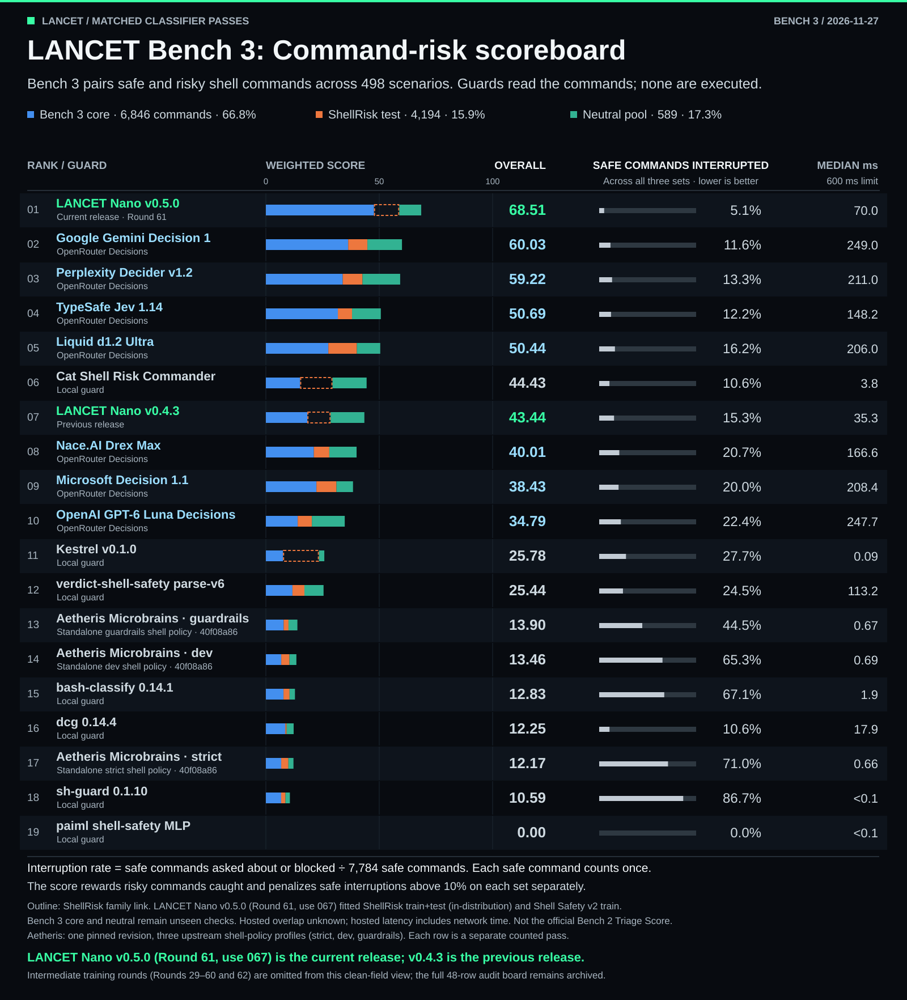

<h1 align="center">LANCET Nano</h1>
<p align="center">A tiny, local classifier for shell command risk: Bash, PowerShell and cmd.</p>
<p align="center"><strong>v0.5.0 · 111M parameters · 115 MB · CPU INT8 ONNX · ~70 ms median · offline</strong></p>

<p align="center">
  <a href="https://github.com/TannerMidd/LANCET-model/releases/tag/v0.5.0">Download v0.5.0</a> ·
  <a href="https://huggingface.co/spaces/fingerthief/lancet-nano">Try it in your browser</a> ·
  <a href="https://huggingface.co/fingerthief/lancet-nano">Hugging Face</a> ·
  <a href="https://tannermidd.github.io/LANCET-model/">Website</a> ·
  <a href="bundle/MODEL_CARD.md">Model card</a> ·
  <a href="bundle/README.md">Usage</a> ·
  <a href="benchmarks/lancet-bench-1/">Benchmark data</a> ·
  <a href="LICENSE.md">Licenses</a>
</p>

**Model: Apache-2.0. Runtime: MIT.** You may use, modify and redistribute it, including commercially, under the respective terms. Training data is not included or relicensed.

<p align="center"></p>

## What's new in v0.5.0

- **#1 on LANCET Bench 3 at `68.51` overall (`+25.07` over v0.4.3's `43.44`)**, ahead of every local guard and every hosted frontier decision API tested (`Google Gemini Decision 1`: `60.03`, `Perplexity Decider v1.2`: `59.22`, `TypeSafe Jev 1.14`: `50.69`), while running 100% locally on CPU in **`70.0 ms` median** (`110.55 MB` INT8 ONNX).
- **Unseen Bench 3 Core leaped `27.36 → 71.31`:** The only guard tested to clear `70%+` risky catch (`71.31%`) while staying cleanly under the 10% safe-interruption cliff (**`9.93%`**, down from `30.8%` in v0.4.3).
- **Lowest false-alarm rate among top guards (`5.13%` pooled):** Cuts pooled safe interruptions across all `7,784` safe commands from `15.3%` (v0.4.3) down to **`5.13%`** — less than half of hosted frontier APIs (`11.6%–22.4%`).
- **Explicit shell tagging (`semantic-windowed-3`):** Prefixes commands with `<shell=bash>`, `<shell=powershell>`, or `<shell=cmd>` before 512-token overlapping windowing (no silent truncation up to 8,192 UTF-8 bytes).
- **Multi-shell wrapper invariance & pipeline mastery:** Trained on `97,662` protected-clean rows including `27,920` paired wrapped contrasts across all 15 Bash, PowerShell, and `cmd` wrappers plus an explicit unwrapped-to-wrapped consistency loss — lifting PowerShell pipeline catch to **`76.8%`** and Bash pipeline catch to **`58.1%`** while cutting wrapper false alarms sharply.
- **Robustness expected-action rate:** **`94.12%`**.

## Bench 3 scoreboard (`11,859` inert singleton commands)

Bench 3 pairs safe and risky shell commands across 498 scenarios (`6,846` Core commands, `66.8%` weight), ShellRisk test (`4,194`, `15.9%`), and a Neutral pool (`589` commands: Shell Safety v2 test + Rogue, `17.3%`). Every risky command asked about or blocked earns credit; safe interruptions above 10% penalize each set proportionally.

> **Disclosure:** Per owner policy (`evals/protected-19.json`), LANCET Nano v0.5.0 fitted on the upstream ShellRisk-Bench train and test splits (with GPL `gtfobins` and `nl2bash` origins excluded); **ShellRisk test is therefore in-distribution for v0.5.0 and is not an external check.** **Bench 3 Core (`6,846` commands)** and the **Neutral pool (`589` commands)** stayed strictly unseen (`Guard.assert_clean` verified, zero commands executed).

| Rank | Guard | Mode | Overall | Bench 3 Core *(unseen)* | ShellRisk test | Neutral pool *(unseen)* | Safe stopped (pooled) | Median ms |
|---:|---|---|---:|---:|---:|---:|---:|---:|
| **01** | **LANCET Nano v0.5.0** | **Current release · Local CPU** | **68.51** | **71.31** | **70.47** *(in-dist)* | 55.90 | **5.1%** | **70.0** |
| 02 | Google Gemini Decision 1 | Hosted API (OpenRouter) | 60.03 | 54.32 | 53.37 | 88.21 | 11.6% | 249.0 |
| 03 | Perplexity Decider v1.2 | Hosted API (OpenRouter) | 59.22 | 50.71 | 54.92 | **96.07** | 13.3% | 211.0 |
| 04 | TypeSafe Jev 1.14 | Hosted API (OpenRouter) | 50.69 | 47.52 | 39.38 | 73.36 | 12.2% | 148.2 |
| 05 | Liquid d1.2 Ultra | Hosted API (OpenRouter) | 50.44 | 41.23 | 79.27 | 59.57 | 16.2% | 206.0 |
| 06 | Cat Shell Risk Commander | Local guard | 44.43 | 22.59 | 90.16 | 86.90 | 10.6% | 3.8 |
| 07 | LANCET Nano v0.4.3 | Previous release · Local CPU | 43.44 | 27.36 | 64.77 | 86.03 | 15.3% | 35.3 |
| 08 | Nace.AI Drex Max | Hosted API (OpenRouter) | 40.01 | 31.67 | 42.89 | 69.62 | 20.7% | 166.6 |
| 09 | Microsoft Decision 1.1 | Hosted API (OpenRouter) | 38.43 | 33.37 | 55.65 | 42.19 | 20.0% | 208.4 |
| 10 | OpenAI GPT-6 Luna Decisions | Hosted API (OpenRouter) | 34.79 | 21.01 | 39.38 | 83.84 | 22.4% | 247.7 |
| 11 | Kestrel v0.1.0 | Local guard | 25.78 | 11.30 | 100.00 | 13.60 | 27.7% | 0.09 |
| 12 | verdict-shell-safety parse-v6 | Local guard | 25.44 | 17.54 | 33.26 | 48.80 | 24.5% | 113.2 |
| 13 | Aetheris Microbrains · guardrails | Local policy | 13.90 | 11.75 | 13.39 | 22.69 | 44.5% | 0.67 |
| 14 | Aetheris Microbrains · dev | Local policy | 13.46 | 10.14 | 22.85 | 17.65 | 65.3% | 0.69 |
| 15 | bash-classify 0.14.1 | Local rules | 12.83 | 11.65 | 16.78 | 13.79 | 67.1% | 1.9 |
| 16 | dcg 0.14.4 | Local rules | 12.25 | 12.84 | 3.63 | 17.90 | 10.6% | 17.9 |
| 17 | Aetheris Microbrains · strict | Local policy | 12.17 | 10.12 | 19.95 | 12.95 | 71.0% | 0.66 |
| 18 | sh-guard 0.1.10 | Local rules | 10.59 | 10.07 | 12.07 | 11.26 | 86.7% | <0.1 |
| 19 | paiml shell-safety MLP | Local guard | 0.00 | 0.00 | 0.00 | 0.00 | 0.0% | <0.1 |

## Quick start

Download the [release ZIP](https://github.com/TannerMidd/LANCET-model/releases/download/v0.5.0/lancet-v0.5.0-nano-cpu-int8.zip) and its [checksum](https://github.com/TannerMidd/LANCET-model/releases/download/v0.5.0/SHA256SUMS.txt) (`SHA-256: 16e2d812301530ffd7c99c8df909936c4c26f2ccff1adfc6e7a193445906c671`), verify and extract it, then run:

```bash
python verify_bundle.py --strict
python -m venv .venv
.venv/bin/python -m pip install -r requirements.txt
OPENBLAS_NUM_THREADS=1 printf '{"command":"kubectl delete namespace production","shell":"bash"}\n' | .venv/bin/python classify.py --model model
OPENBLAS_NUM_THREADS=1 printf '{"command":"Get-ChildItem C:\\\\AppData\\\\Logs | Remove-Item -Force","shell":"powershell"}\n' | .venv/bin/python classify.py --model model
```

Send JSON lines with a `command` string and `shell` set to `bash`, `powershell` or `cmd`. Each input is classified as `risky`, `review` or `not_flagged`. Inputs are inert text and are **never executed**. No API key or network connection is needed after installation. See the [full instructions](bundle/README.md).

If you clone the repository instead of downloading the ZIP, install Git LFS, run `git lfs pull`, and use `bundle/`.

## How it was trained

LANCET Nano v0.5.0 is built on the Salesforce **CodeT5+ 220M** encoder (`Salesforce/codet5p-220m` → Round 25 Preview → Round 60 → Round 61 `wise-ep1-065`), fine-tuned on `97,662` protected-clean rows (`36,674` complete contrast pairs) with:
- Native raw-BCE logit scaling and bounded ReLU boundary sharpening (`safe <= 3.0`, `risky >= 8.0`)
- Selective parent logit-preservation anchoring (`0.30 * SmoothL1`) on `43,367` already-correct base rows
- Explicit wrapper-invariance consistency (`0.22 * SmoothL1`) across `27,920` paired wrapped commands covering all 15 Bash, PowerShell, and `cmd` wrappers
- WiSE-FT weight-space interpolation (`0.65 * epoch-01 + 0.35 * Round 60`) selected strictly on `13,634` disjoint 6-stratum hard-dev rows, with INT8 thresholds calibrated once on held-out development safe rows

**No hosted language-model output (including TypeSafe Jev) was used as a training label, teacher target, or selection signal.** See the [model card](bundle/MODEL_CARD.md) and [source notices](bundle/THIRD-PARTY-NOTICES.md).

## Boundaries

- **Triage guardrail, not a sandbox:** Nano sees only command text — no filesystem state, remote scripts, or task context. Always pair with OS sandboxing and least privilege.
- **Conservative hard-block tier:** At the shipped thresholds, ~98% of flagged risky commands return `review` (`ask`) rather than silent `risky` (`block`), keeping false hard blocks near zero (`7/7,784` pooled).
- **`not_flagged` is not execution authorization or a safety guarantee.** Other shells, invalid input, or more than 8,192 UTF-8 bytes return `review`, with no silent truncation.

## Versions

- **v0.5.0 — LANCET Nano, CodeT5+ 220M, shell-tagged windowed** (current): Bench 3 score **68.51** (`#1/19`), unseen Core **71.31** (`9.93%` safe int), `5.13%` pooled safe int, `70.0 ms` CPU.
- [v0.4.3 — LANCET Nano, CodeT5+ 220M, windowed](https://github.com/TannerMidd/LANCET-model/releases/tag/v0.4.3): Bench 3 score `43.44` (Bench 2 Triage `68.3`).
- [v0.4.2](https://github.com/TannerMidd/LANCET-model/releases/tag/v0.4.2) · [v0.4.1](https://github.com/TannerMidd/LANCET-model/releases/tag/v0.4.1) · [v0.4.0](https://github.com/TannerMidd/LANCET-model/releases/tag/v0.4.0) · [v0.3.0](https://github.com/TannerMidd/LANCET-model/releases/tag/v0.3.0) · [v0.2.0](https://github.com/TannerMidd/LANCET-model/releases/tag/v0.2.0) · [v0.1.0](https://github.com/TannerMidd/LANCET-model/releases/tag/v0.1.0).

## Credits

LANCET is built on Salesforce CodeT5+ by **Yue Wang, Hung Le, Akhilesh Deepak Gotmare, Nghi D. Q. Bui, Junnan Li and Steven C. H. Hoi**. Training commands include **ShellRisk-Bench** by Kontext Security (with **Atomic Red Team** by Red Canary and **InternalAllTheThings**), **Shell Safety v2** by tomngdev, and project-authored curricula. Runtime and LANCET contributions: **Tanner Middleton**.

See the [full credits](bundle/NOTICE.txt), [source notices](bundle/THIRD-PARTY-NOTICES.md) and [model changes](bundle/MODIFICATIONS.md).
